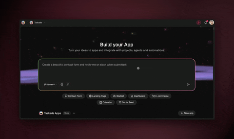

# Taskade vs Coda: An Honest Comparison (and Coda Alternative Guide)

If you're weighing a **Coda alternative**, you already know the appeal of Coda: it turns a document into something that behaves like an app — tables, formulas, buttons, and connected data all living on one page. That's a genuinely powerful idea, and Coda does it better than almost anyone.

Taskade makes a different bet. Instead of asking you to assemble an app by hand from formulas and building blocks, Taskade is an **AI-native workspace** where you describe what you want in plain English and **Taskade Genesis** builds a complete, hosted app for you — with AI agents and automations running inside it.

This page is written to be fair. Coda is an excellent product, and for power users who love building custom doc-tooling, it may be the better tool. Below we lay out where each one genuinely wins, so you can decide based on how you actually work.

> Short version: **Coda** is a doc-database hybrid — "docs that act like apps" — that you assemble yourself from tables, formulas, buttons, and Packs. **Taskade** is an AI-native workspace where memory (projects + notes), intelligence (multi-agent teams), and execution (automations + Genesis apps) live together. If you love hand-crafting formula-driven internal tools, Coda is a more powerful canvas. If you want AI to *build the thing* and run agents inside it, Taskade fits better.

---

## At a glance

| Dimension | Taskade | Coda |
| --- | --- | --- |
| **Core model** | AI-native workspace + prompt-to-hosted-app (Taskade Genesis). | Doc-database hybrid: documents that behave like apps. |
| **Building approach** | Describe the app in plain English; Genesis builds it. | A human assembles tables, formulas, buttons, and Packs by hand. |
| **AI & agents** | AI-native core: custom multi-agent teams with shared memory and tools. | [Coda AI](https://coda.io/product/ai), included for Doc Makers. |
| **Multi-agent** | Multi-agent workspaces — agents collaborate, hand off, and run as a team. | See [Coda AI](https://coda.io/product/ai). |
| **App output** | A standalone, hosted app with sign-in, payments, and a custom domain (Pro and up). | An interactive doc that lives inside Coda. |
| **Automations** | Visual automation flows plus an AI workflow generator; describe it, get a flow. | Automations and buttons inside a doc; mature and flexible for in-doc logic. |
| **Integrations** | 100+ integrations (Taskade's claim) — Slack, Stripe, Gmail, Notion, and more. | 600+ Packs — a large, well-established connector ecosystem. |
| **In-app payments** | Yes — Genesis apps support Stripe-backed checkout and paywalls out of the box. | Check Coda's current features. |
| **Pricing model** | Each plan includes a set number of users and monthly AI credits; paid plans add more credits, agents, and runs. | Per-Doc-Maker (creators pay; editors/viewers free). See [Coda pricing](https://coda.io/pricing). |
| **Best for** | Teams that want AI to build the app and run agents inside it. | Power users who love formula-driven, custom doc-tooling without code. |

*Feature availability and pricing change often. Verify current details on [taskade.com](https://www.taskade.com) and coda.io before deciding.*

---

## Where Coda shines

We'll say it plainly: Coda's core idea is excellent, and the execution is mature. If your decision hinges on hand-built, structured-data tooling, this is its home turf.

- **The doc-as-app model.** Coda blends a writing surface with structured data in a way few tools match. A single doc can hold rich text, multiple linked tables, formulas, and interactive buttons — so a "document" becomes a small internal tool. For bespoke workflows, this flexibility is real.
- **Formulas and structured data.** Coda's formula language is powerful. If you think in spreadsheets and want logic that reacts to your data — rollups, conditional views, computed columns, automations triggered by buttons — Coda gives you a deep, expressive canvas.
- **Packs.** Coda offers **600+ Packs** — connectors that pull live data from other tools into your doc and let buttons push actions back out. The ecosystem is broad and well-established.
- **Custom internal tools without code.** For a builder who enjoys assembling the pieces, Coda can replace a pile of one-off spreadsheets and small apps with a single, tailored doc. That's a legitimately strong outcome.

If you have someone who *enjoys* building with formulas and wants precise control over a custom doc-tool, Coda rewards that investment.

A fair point worth repeating: for deeply customized, formula-driven, structured-data internal tooling, Coda remains a more powerful **builder canvas** than Taskade. We're not going to pretend otherwise.

---

## Where Taskade fits better

Taskade isn't trying to out-formula Coda. It's built around a different idea: you shouldn't have to assemble the app yourself — you should be able to *describe it* and have it built, with intelligence already inside.

- **AI-native.** Taskade was designed around AI from the core, so agents, memory, and automation are how the product works. See [the AI workspace pillar](../guides/ai-workspace.md).
- **Describe it instead of building it.** This is the biggest difference. With [Taskade Genesis](https://www.taskade.com/ai/apps), you describe an app in plain English and get a complete, hosted, working app — database, AI agents, automations, UI, login/auth, payments, and a custom domain. In Coda, *you* assemble the tables, formulas, and buttons. With Genesis, the workspace builds it for you, then you refine it by clicking.
- **A real standalone app, not a doc.** A Coda build lives inside Coda as an interactive document. A Genesis app is standalone software at a live URL — with its own login, its own data, and the option to run on your own domain. See [what Taskade Genesis builds](../genesis/what-is-taskade-genesis.md).
- **Multi-agent teams that take action.** Taskade lets you run a *team* of agents that collaborate and hand off work — a researcher feeding a writer feeding a reviewer — with shared, persistent memory. Read [what a multi-agent workspace is](../guides/multi-agent-workspace.md).
- **Start from a finished app, not a blank doc.** You can clone a live App Kit from the [Taskade App Factory](https://www.taskade.com/apps) in about a minute — data, agents, and automations already wired up — then make it yours. See [clone-ready App Kits](../genesis/app-kits.md).

One enterprise customer described shipping a production business app solo with Genesis this way: *"What I accomplished in a few weeks would have taken a team of 40+ and 18 months in the Fortune 500."* We share that not as a benchmark you should expect, but as an honest signal of what "build without engineers" can look like in practice.

---

## A note on AI pricing

It's worth being precise here, because "AI is included" gets thrown around loosely.

**Coda AI** is included for Doc Makers, per [Coda AI](https://coda.io/product/ai). Check [Coda pricing](https://coda.io/pricing) for the current limits.

**Taskade** includes AI in the workspace itself — agents, automations, and the workflow generator are part of how the product works. Each Taskade plan includes a set number of users and a monthly allowance of AI credits, and Free starts with 0 credits that you earn with referrals and invites. Paid plans add more credits, more agents, and more automation runs. (As always, verify current limits on each vendor's pricing page.)

---

## A note on the name

Coda is now Superhuman Docs, per [Coda AI](https://coda.io/product/ai). Check Coda's current pages for the latest product names and packaging before you commit.

---

## How they compare in practice

Feature tables only get you so far. Here's how the two tools tend to feel across the work people actually do.

**Building an internal tool.**
In Coda, you start with a doc, add tables, write formulas, wire up buttons, and connect Packs until the doc behaves like the tool you wanted. It's powerful, and for someone who enjoys it, it's satisfying. In Taskade, you describe the tool in plain English and Genesis generates it — database, UI, and the agents that operate it — then you refine by clicking. Coda asks you to *assemble*; Genesis asks you to *describe*.

**Getting AI to help.**
Coda AI helps inside your doc. In Taskade, AI is the substrate: you can stand up a dedicated agent, train it on your own documents, choose its model, and give it tools so it can take actions, not just respond. The mental model is "a team of teammates I assign work to."

**Shipping something for people outside the team.**
This is where the products diverge most. A Coda build is an interactive document that lives inside Coda. When you need a customer-facing app — a portal, a storefront, an intake tool with its own login and payments — that's a different kind of artifact. Genesis ships exactly that: a hosted app with auth, a database, Stripe-backed payments, and a custom domain. See a worked example in [build a CRM with AI](../genesis/build-a-crm-with-ai.md).

**Connecting your other tools.**
Both tools connect to your stack. Coda's **600+ Packs** are a genuine strength and a broader catalog than Taskade's **100+ integrations**. If raw connector count is your deciding factor, Coda is ahead. Taskade's edge isn't breadth — it's that agents and automations use those connections to *act* on your behalf inside the workspace.

---

## A fair word on the build-it-yourself trade-off

This isn't a knock — it's a trade-off worth naming. Coda's strength is that you build precisely what you want, formula by formula. The flip side is that you have to build it: someone has to design the tables, write the logic, and maintain it as needs change. Many builders love that control. Others want the outcome without becoming the maintainer of a custom doc.

Taskade makes the opposite bet: describe the outcome, let AI build and wire it, and refine by clicking. That bet costs you some of Coda's fine-grained, formula-level control. If your tooling is unusual and you want to hand-tune every cell and rule, Coda's canvas may matter more. If your goal is to get a real app — with agents and payments — *running* this week, the describe-it path tends to win.

Neither bet is "right." They serve different goals. Pick the one that matches yours.

---

## Which should you choose?

**Choose Coda if:**

- You love building with formulas, tables, and buttons, and want precise control over a custom doc-tool.
- Your tooling lives naturally as a document — structured data plus rich text on one surface.
- You rely on a broad connector ecosystem (Packs) and enjoy assembling the pieces yourself.
- You're comfortable with a per-Doc-Maker pricing model.

**Choose Taskade if:**

- You want to describe an app in plain English and have it built — database, UI, auth, and payments included.
- You want AI agents that actually do work — research, drafting, triage, execution.
- You want to ship standalone, hosted apps without engineers, in weeks not months, with no code.

**Honest middle ground:** some teams keep Coda for a few beloved formula-heavy internal docs and use Taskade for AI agents, automations, and shipping real customer-facing apps. There's no rule that says you must pick exactly one — match each tool to the job it's best at.

---

## FAQ

**Is Taskade a real Coda alternative?**
Yes, for most teams — especially if AI and shipping real apps matter to you. Coda builds "docs that act like apps" by hand with formulas and Packs; Taskade Genesis turns a plain-English prompt into a standalone hosted app, and agents are first-class across the workspace.

**Does Coda build real, standalone apps?**
Coda builds interactive documents that behave like apps, but they live inside Coda. Taskade Genesis builds a standalone, hosted app — its own URL, login/auth, database, Stripe payments, and a custom domain. Different artifacts: a powerful doc versus running software you can hand to customers.

**Is Coda AI included?**
Coda AI is included for Doc Makers, per [Coda AI](https://coda.io/product/ai). Check [Coda pricing](https://coda.io/pricing) for the limits. Each Taskade plan includes a set number of users and a monthly allowance of AI credits, and Free starts with 0 credits that you earn with referrals and invites.

**What about Superhuman Docs?**
Coda is now Superhuman Docs, per [Coda AI](https://coda.io/product/ai). Check Coda's live pages before deciding, because names and AI packaging can change.

**Does Coda have more integrations than Taskade?**
Yes — Coda lists 600+ Packs, a broader connector catalog than Taskade's 100+ integrations. Taskade's advantage isn't breadth but that agents and automations use those connections to take action inside the workspace, not just pull data into a doc.

**Do I need to be technical to use Taskade?**
No. The whole point is plain English. If you can describe what you want, you can build agents, automations, and apps with [Taskade Genesis](https://www.taskade.com/blog/introducing-taskade-genesis) — no formulas required.

---

## Related

- [What Taskade Genesis builds](../genesis/what-is-taskade-genesis.md)
- [The AI workspace pillar](../guides/ai-workspace.md)
- [Clone-ready App Kits](../genesis/app-kits.md)
- [Taskade vs Notion](../compare/taskade-vs-notion.md)
- [Compare hub: all Taskade alternatives](../compare/README.md)

---

**Ready to try the AI-native approach?** Describe an app in plain English and watch it build with [Taskade Genesis](https://www.taskade.com/ai/apps) — or start free at [taskade.com](https://www.taskade.com).
